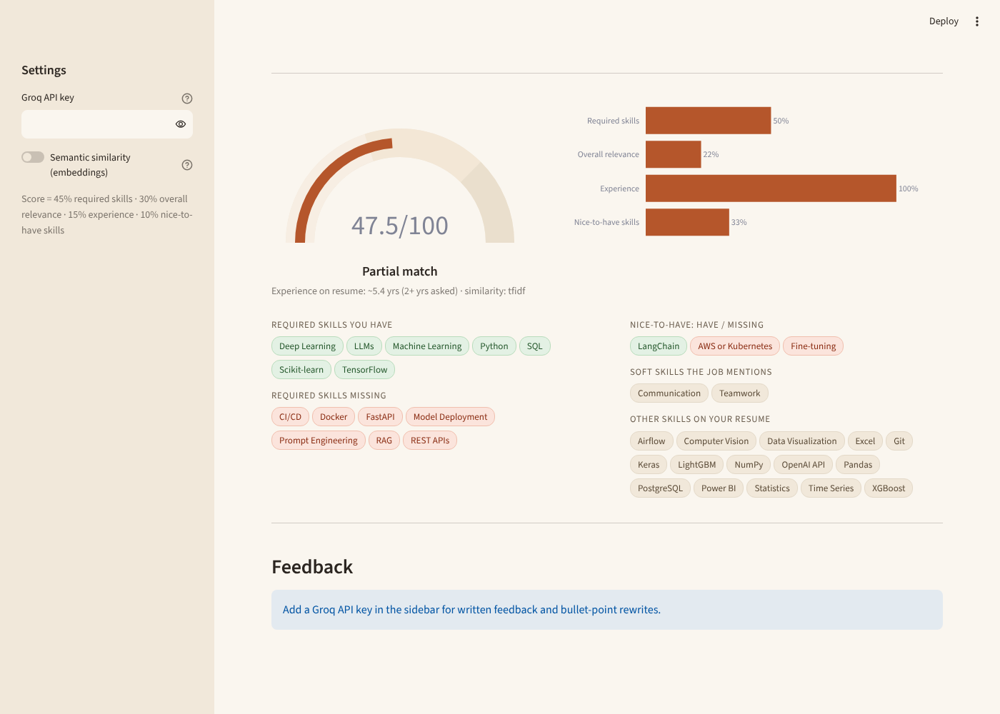

# Resume vs Job Matcher

Scores how well a resume fits a job description, shows exactly which required skills are there and which are missing, and uses an LLM (GPT-OSS 120B on Groq) to suggest stronger, job-specific bullet points.



## What it does

- **Upload a resume** (PDF, DOCX or TXT) and paste a job description
- **Match score out of 100**, built from four parts you can see:

  | Part | Weight | How it's measured |
  |---|---|---|
  | Required skills | 45% | share of the job's required skills found on the resume |
  | Overall relevance | 30% | semantic similarity between resume and job (embeddings, or TF-IDF as a fallback) |
  | Experience | 15% | years on the resume vs the minimum the job asks for |
  | Nice-to-have skills | 10% | coverage of the "preferred / nice to have" section |

- **Skill chips:** required skills you have, required skills missing, nice-to-haves, soft skills the job mentions, and other skills on your resume
- **LLM feedback** (optional, needs a free Groq key):
  - a short honest summary, strengths and gaps
  - 3 of your own bullet points rewritten for this job
  - keywords to add *if they're true for you*
  - Returned as JSON, so the UI can lay it out properly.

## Details that make the score more accurate

- **70+ skills with aliases.** "sklearn", "scikit learn" and "scikit-learn" all count as the same skill. The matching is careful with tricky names like C++, C#, Next.js and R (capital R only, so "R&D" doesn't count).
- **Alternatives are understood.** "PyTorch or TensorFlow" is one requirement that either skill satisfies, so a TensorFlow user isn't marked as missing PyTorch.
- **Implied skills.** Listing TensorFlow implies deep learning, and PostgreSQL implies SQL.
- **Nice-to-haves are separated.** The "Nice to have" / "Preferred" section is detected and weighted less, so a missing bonus skill doesn't sink the score.
- **Experience is calculated from job dates.**
  - It reads date ranges like "Mar 2023 - Present".
  - Overlapping jobs are merged.
  - Education dates are ignored.
- **Soft skills don't affect the score.** Keyword matching can't judge communication skills fairly, so they're only listed for reference.

## Example

On the included sample resume (a data scientist with about 5 years of experience):

| Job | Score | Verdict | Main gaps |
|---|---|---|---|
| Senior Data Analyst | 75 | Strong match | BigQuery |
| Machine Learning Engineer | 48 | Partial match | Docker, FastAPI, CI/CD, RAG, model deployment |

That's what a recruiter would conclude too: strong analytics background, not yet production ML engineering.

## Quick start

```bash
git clone https://github.com/Fasiuu/resume-job-matcher
cd resume-job-matcher
pip install -r requirements.txt
cp .env.example .env     # optional: add a free Groq key from console.groq.com
streamlit run app.py
```

## Tests

```bash
pytest -q
```

16 tests cover skill aliases and false positives, "or" requirements, implied skills, experience parsing, nice-to-have detection, and the final scores on the sample data.

## Project structure

```
app.py                 Streamlit UI
matcher/skills.py      skill taxonomy, aliases, implied skills, "or" groups
matcher/parsing.py     file reading, required years, experience dates, job sections
matcher/scoring.py     the weighted match score
matcher/feedback.py    Groq prompt + JSON parsing
samples/               sample resume and two job descriptions
tests/                 pytest suite
```
